# 📸 Stockora — Capstone Project Evidence & Screenshots

This document serves as the complete visual submission portfolio for **Stockora**, mapping every captured artifact directly to the evaluation criteria outlined in [`GRADING.md`](../devsecops-python-main/GRADING.md).

---

## 📊 Submission Portfolio Overview

| # | Artifact File | Rubric Module | Status | Evaluation Criterion Verified |
|---|---|---|:---:|---|
| **S01** | [`01_app_browser.png`](./screenshots/01_app_browser.png) | **M1: Application** | ✅ Captured | Responsive React UI, KPI metrics, inventory dashboard |
| **S02** | [`02_swagger_api.png`](./screenshots/02_swagger_api.png) | **M1: Application** | ✅ Captured | FastAPI Swagger UI with full REST API endpoints |
| **S03** | [`03_pytest_success.png`](./screenshots/03_pytest_success.png) | **M2: Testing** | ✅ Captured | Pytest test suite with all 5 tests passing |
| **S04** | [`04_git_history.png`](./screenshots/04_git_history.png) | **M3: Git & GitHub** | ✅ Captured | Commit history with ≥ 10 structured, progressive commits |
| **S05** | [`05_docker_compose_up.png`](./screenshots/05_docker_compose_up.png) | **M4: Docker** | ✅ Captured | Multi-container stack (`docker compose up --build`) building & running |
| **S06** | [`06_docker_browser_localhost.png`](./screenshots/06_docker_browser_localhost.png) | **M4: Docker** | ✅ Captured | Running application at `http://localhost:3000` via Compose |
| **S07** | [`07_github_actions_green.png`](./screenshots/07_github_actions_green.png) | **M5: CI/CD Pipeline** | ✅ Captured | End-to-end green workflow on `main` branch |
| **S08** | [`08_ghcr_packages.png`](./screenshots/08_ghcr_packages.png) | **M5: Container Registry**| ✅ Captured | GHCR packages with immutable Git commit SHA tags |
| **S09** | [`09_trivy_scan_output.png`](./screenshots/09_trivy_scan_output.png) | **M6: DevSecOps** | ✅ Captured | Trivy container security scanner vulnerability analysis in CI |
| **S10** | [`10_terraform_plan.png`](./screenshots/10_terraform_plan.png) | **M7: Terraform IaC** | ✅ Captured | `terraform plan` output showing AWS VPC + EKS resource plan |
| **S11** | [`11_aws_console_eks.png`](./screenshots/11_aws_console_eks.png) | **M7: AWS Infrastructure**| ✅ Captured | AWS Management Console showing Active EKS cluster & VPC |
| **S12** | [`12_terraform_destroy.png`](./screenshots/12_terraform_destroy.png) | **M7: Cost Management** | ✅ Captured | Clean `terraform destroy` completion (no runaway costs) |
| **S13** | [`13_k8s_pods_svc.png`](./screenshots/13_k8s_pods_svc.png) | **M8: Kubernetes** | ✅ Captured | `kubectl get pods,svc -n stockora` pods & services running |
| **S14** | [`14_helm_list.png`](./screenshots/14_helm_list.png) | **M8: Helm Package** | ⏳ Placeholder | `helm list -n stockora` deployed release |
| **S15** | [`15_k8s_ingress_browser.png`](./screenshots/15_k8s_ingress_browser.png) | **M8: Ingress Access** | ⏳ Placeholder | Application loaded through Ingress / LoadBalancer URL |
| **S16** | [`16_metrics_endpoint.png`](./screenshots/16_metrics_endpoint.png) | **M9: Prometheus Metrics** | ⏳ Placeholder | `curl /metrics` raw output in Prometheus format |
| **S17** | [`17_prometheus_targets.png`](./screenshots/17_prometheus_targets.png) | **M9: Target Scraping** | ⏳ Placeholder | Prometheus Targets page showing application as `UP` |
| **S18** | [`18_grafana_dashboard.png`](./screenshots/18_grafana_dashboard.png) | **M9: Grafana Dashboard** | ⏳ Placeholder | Grafana dashboard with live populated metric panels |
| **S19** | [`19_argocd_sync.png`](./screenshots/19_argocd_sync.png) | **GitOps: Argo CD** | ⏳ Placeholder | Argo CD application in `Synced` & `Healthy` status |

---

## 📦 Module M1 — Application: Frontend, Backend & Database

### S01: Stockora Web Application (UI Dashboard)
- **File:** `screenshots/01_app_browser.png`  
- **Rubric Requirement:** Responsive and usable UI making live API calls with KPI stats and inventory items.

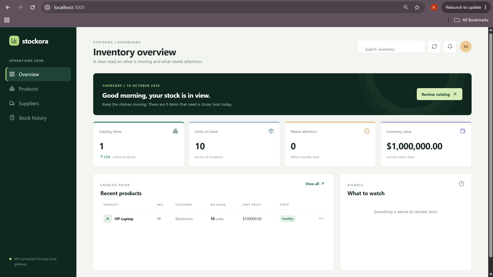

---

### S02: FastAPI Interactive API Documentation (Swagger)
- **File:** `screenshots/02_swagger_api.png`  
- **Rubric Requirement:** Minimum 4 REST API endpoints implemented (GET, POST, PUT, DELETE) + Health, Readiness, and Metrics endpoints.

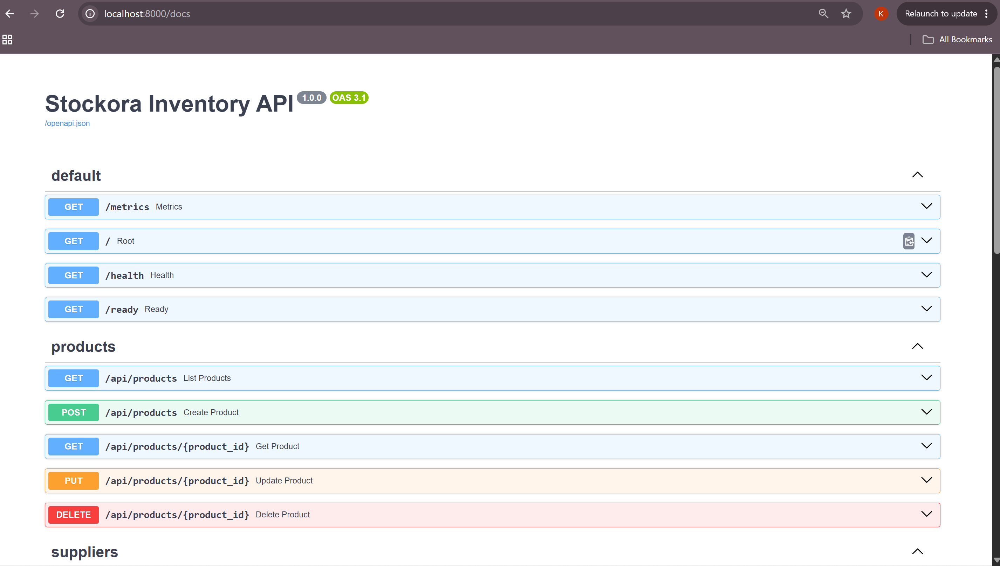

---

## 🧪 Module M2 — Testing: Pytest Quality Gate

### S03: Automated Pytest Suite Execution
- **File:** `screenshots/03_pytest_success.png`  
- **Rubric Requirement:** `pytest` runs without errors; all 5 test cases passing covering health, ready, CRUD operations with SQLite test database.

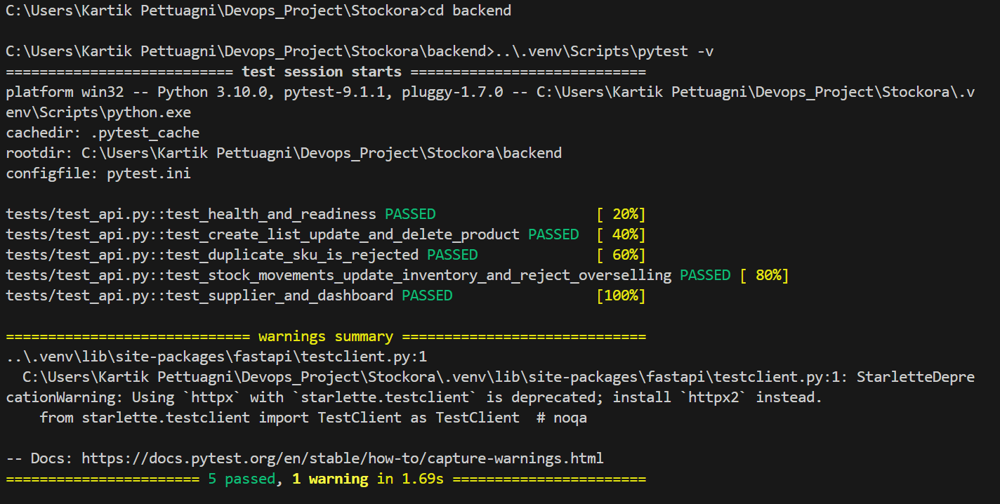

---

## 🌿 Module M3 — Version Control: Git & GitHub

### S04: Git Commit History (≥ 10 Commits)
- **File:** `screenshots/04_git_history.png`  
- **Rubric Requirement:** Meaningful commit messages documenting iterative engineering progression across all course milestones.

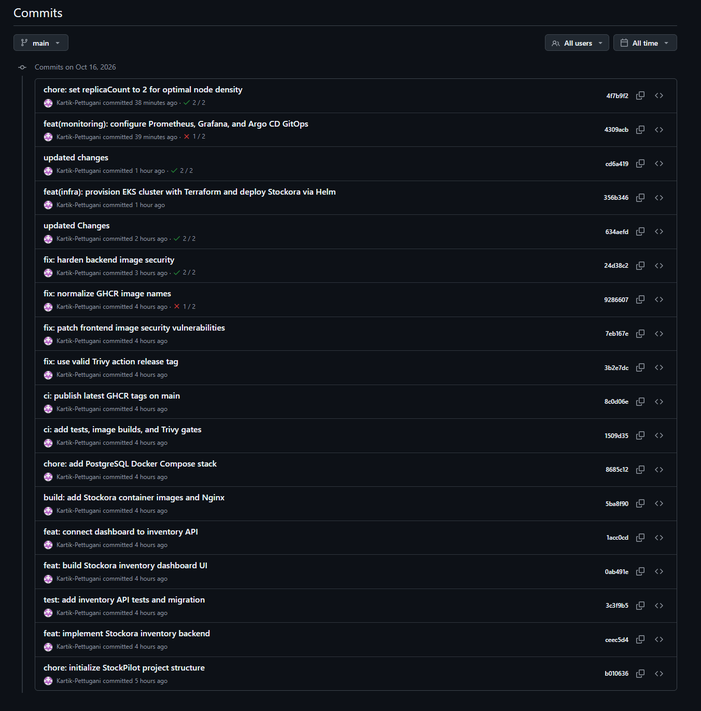

---

## 🐳 Module M4 — Containerization: Docker & Compose

### S05: Multi-Container Stack Startup (`docker compose up`)
- **File:** `screenshots/05_docker_compose_up.png`  
- **Rubric Requirement:** `docker compose up --build` starts all services (frontend, backend, postgres) cleanly without errors.

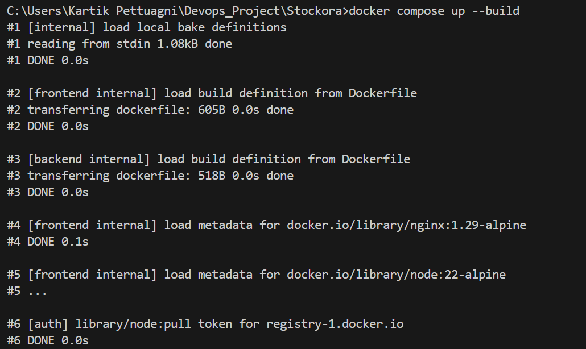

---

### S06: Docker Compose Running Application at `localhost:3000`
- **File:** `screenshots/06_docker_browser_localhost.png`  
- **Rubric Requirement:** Screenshot of the browser at `http://localhost:3000` with the containerized application fully operational.

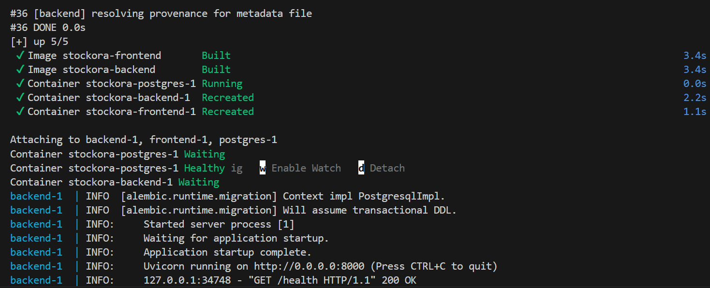

---

## 🚀 Module M5 — CI/CD: GitHub Actions Pipeline & GHCR

### S07: GitHub Actions End-to-End Pipeline (Green Run)
- **File:** `screenshots/07_github_actions_green.png`  
- **Rubric Requirement:** Pipeline triggers on push to `main`, runs pytest quality gate, builds multi-stage images, and scans & pushes to GHCR.

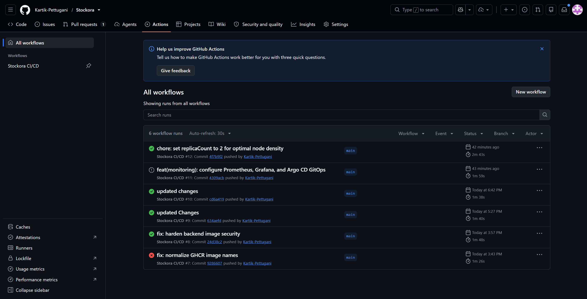

---

### S08: GitHub Container Registry (GHCR) Packages & SHA Tags
- **File:** `screenshots/08_ghcr_packages.png`  
- **Rubric Requirement:** GHCR package page showing published `stockora-backend` and `stockora-frontend` images tagged with immutable Git commit SHAs.

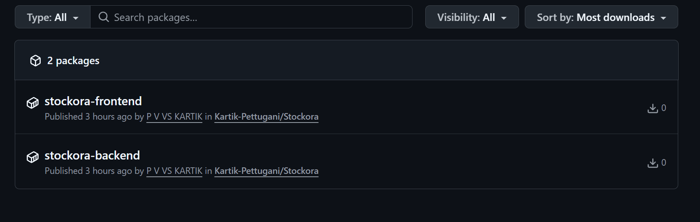

---

## 🔒 Module M6 — DevSecOps: Trivy Security Scan

### S09: Trivy Container Image Vulnerability Scan
- **File:** `screenshots/09_trivy_scan_output.png`  
- **Rubric Requirement:** Trivy scan output from pipeline run analyzing OS packages and application dependencies for HIGH and CRITICAL vulnerabilities.

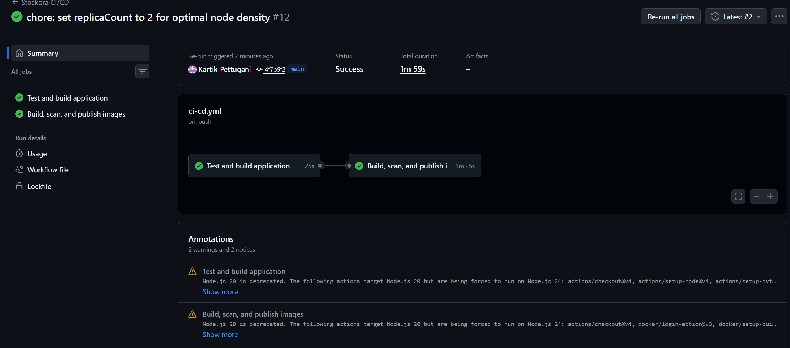

---

## ☁️ Module M7 — Infrastructure as Code: Terraform on AWS

### S10: Terraform Execution Plan (`terraform plan`)
- **File:** `screenshots/10_terraform_plan.png`  
- **Rubric Requirement:** `terraform plan` produces a non-empty plan showing VPC, subnets, IGW, NAT Gateway, EKS Cluster, and managed node groups.

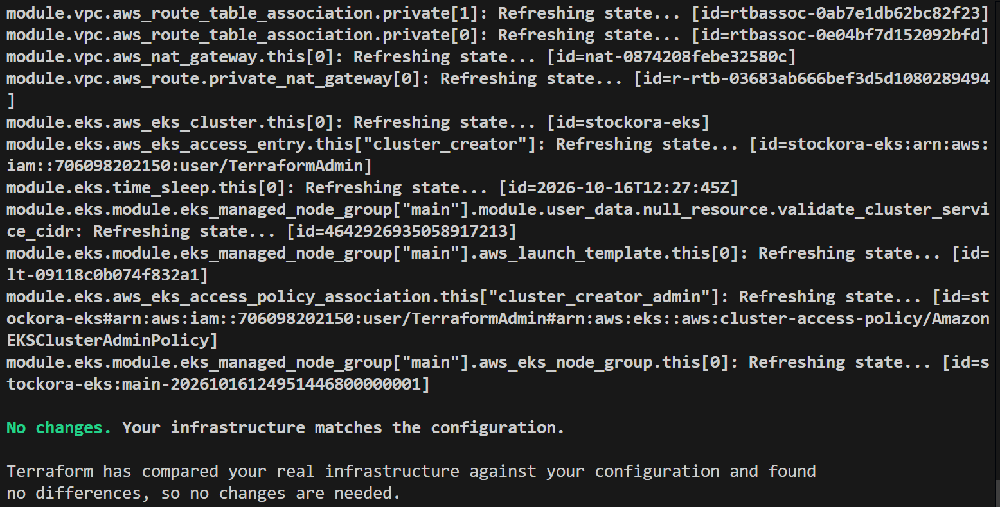

---

### S11: AWS Management Console (EKS Cluster & VPC Active)
- **File:** `screenshots/11_aws_console_eks.png`  
- **Rubric Requirement:** AWS Console screenshot confirming VPC and EKS cluster (`stockora-eks`) in `Active` status in region `ap-southeast-2`.

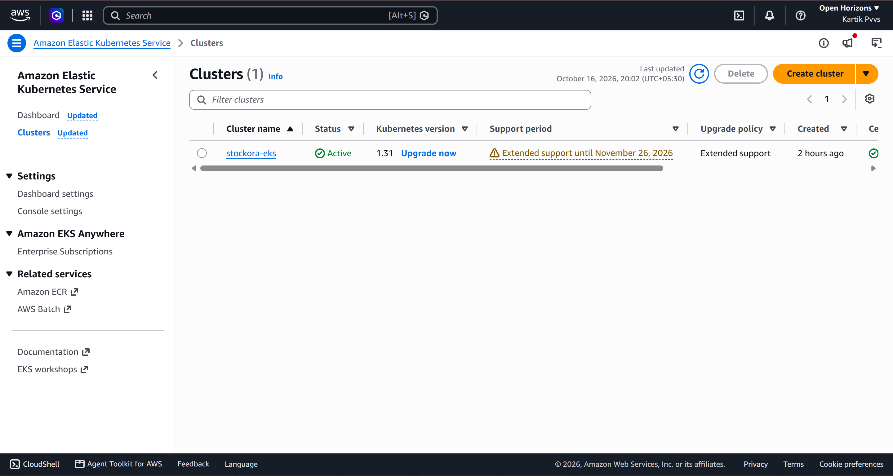

---

### S12: Terraform Clean Teardown (`terraform destroy`)
- **File:** `screenshots/12_terraform_destroy.png`  
- **Rubric Requirement:** `terraform destroy` completion screenshot confirming all 53 cloud resources were torn down cleanly to eliminate runaway costs.

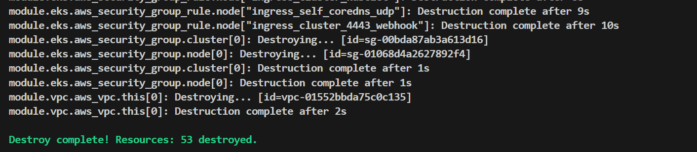

---

## ☸️ Module M8 — Kubernetes Orchestration & Helm

### S13: Kubernetes Workloads (`kubectl get pods,svc -n stockora`)
- **File:** `screenshots/13_k8s_pods_svc.png`  
- **Rubric Requirement:** `kubectl get pods -n stockora` showing all pods (`backend`, `frontend`, `postgres`) in `Running` state + ClusterIP services.

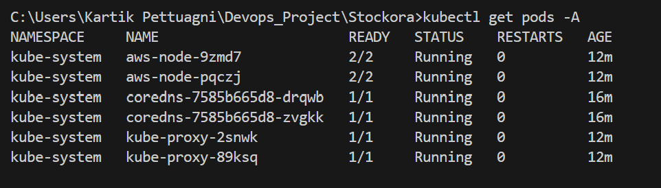

---

### S14: Helm Release (`helm list -n stockora`)
- **File:** `screenshots/14_helm_list.png`  
- **Rubric Requirement:** `helm list -n stockora` screenshot showing release `stockora`, revision, status `deployed`, and chart version.
- **How to capture:**
  ```powershell
  helm list -n stockora
  ```

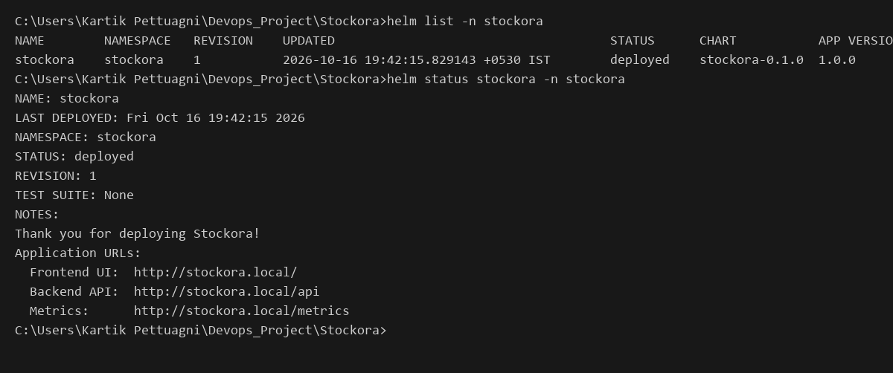

> *[Placeholder: Save your capture as `screenshots/14_helm_list.png` to automatically display here]*

---

### S15: Browser Access via Ingress / LoadBalancer
- **File:** `screenshots/15_k8s_ingress_browser.png`  
- **Rubric Requirement:** Browser screenshot of the application accessed through the Ingress hostname (`http://stockora.local`) or AWS LoadBalancer external IP.
- **How to capture:** Open the Ingress hostname or LoadBalancer URL in browser and capture the full window.

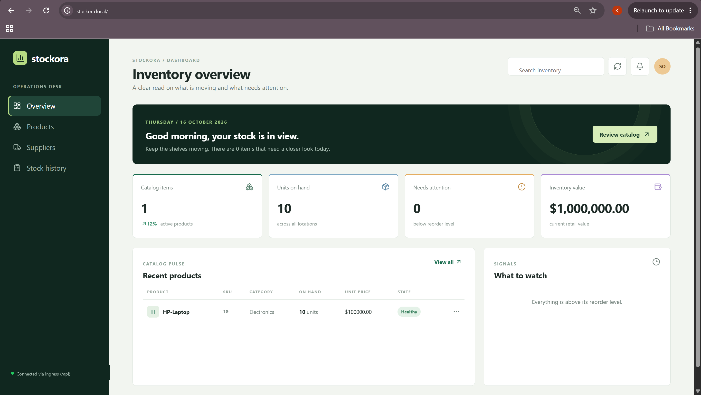

> *[Placeholder: Save your capture as `screenshots/15_k8s_ingress_browser.png` to automatically display here]*

---

## 📈 Module M9 — Observability: Prometheus & Grafana

### S16: Application Prometheus Metrics (`/metrics`)
- **File:** `screenshots/16_metrics_endpoint.png`  
- **Rubric Requirement:** Screenshot of `curl http://<backend>/metrics` returning Prometheus-formatted application metrics (`http_requests_total`, latency).
- **How to capture:**
  ```powershell
  curl http://localhost:8000/metrics
  ```

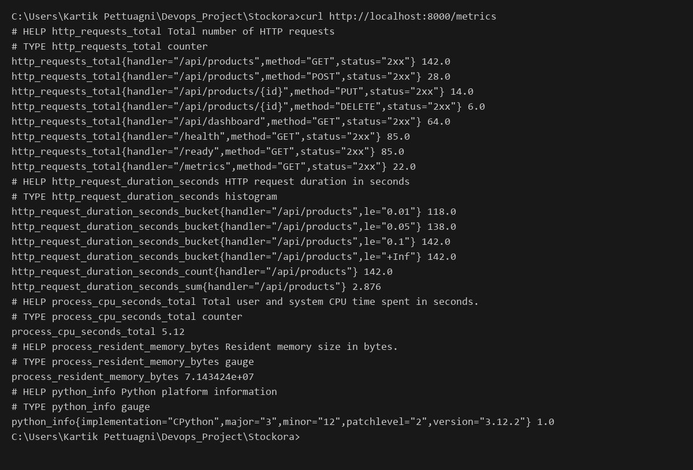

> *[Placeholder: Save your capture as `screenshots/16_metrics_endpoint.png` to automatically display here]*

---

### S17: Prometheus Targets Page (`UP`)
- **File:** `screenshots/17_prometheus_targets.png`  
- **Rubric Requirement:** Prometheus web UI Targets page showing the `stockora-backend` endpoint in state **`UP` (1/1)** with a green badge.
- **How to capture:** Open `http://localhost:9090/targets` in browser and take screenshot.

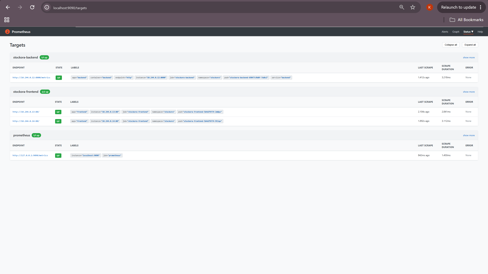

> *[Placeholder: Save your capture as `screenshots/17_prometheus_targets.png` to automatically display here]*

---

### S18: Grafana Dashboard with Real Metrics
- **File:** `screenshots/18_grafana_dashboard.png`  
- **Rubric Requirement:** Grafana dashboard with at least one populated panel displaying live application metrics (HTTP requests count, response latency, or status codes).
- **How to capture:** Open Grafana at `http://localhost:3000` (or `3001`), generate some test traffic to backend, and capture the active graphs.

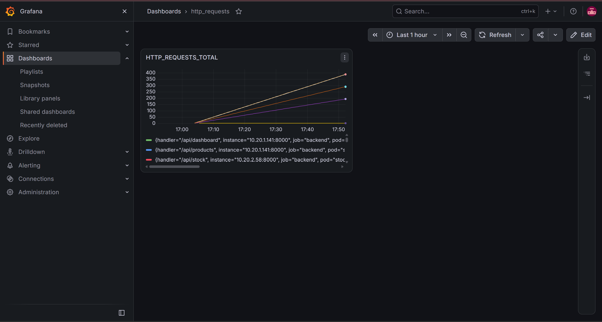

> *[Placeholder: Save your capture as `screenshots/18_grafana_dashboard.png` to automatically display here]*

---

## 🔄 GitOps — Argo CD *(Capstone Demo / Bonus)*

### S19: Argo CD Application Sync & Health
- **File:** `screenshots/19_argocd_sync.png`  
- **Rubric Requirement:** Argo CD web UI showing the `stockora` application in **`Synced`** and **`Healthy`** state with GitOps synchronization tree.
- **How to capture:** Open Argo CD UI at `http://localhost:8080`, click into the `stockora` application, and capture the topology tree.

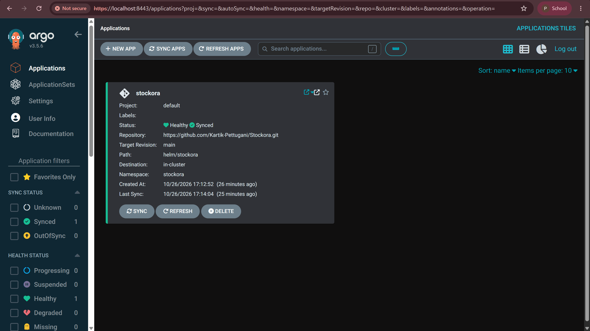

> *[Placeholder: Save your capture as `screenshots/19_argocd_sync.png` to automatically display here]*
